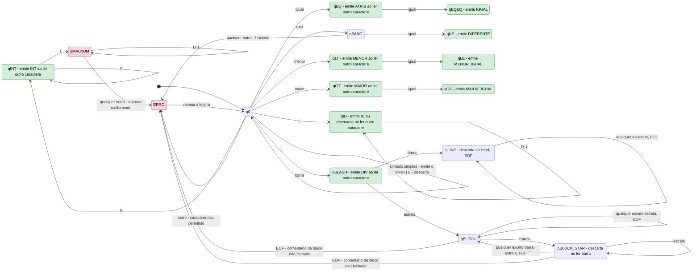

# Definição formal da MiniLang

Este documento define a MiniLang em três níveis, um para cada fase do compilador:

1. **Léxico**: o alfabeto e os tokens, descritos por expressões regulares e reconhecidos por um AFD (seção [Lexer](#lexer)).
2. **Sintático**: uma gramática livre de contexto em EBNF, com precedência e associatividade embutidas na estrutura das produções.
3. **Semântico**: restrições que uma gramática livre de contexto não consegue expressar (tipos, variável definida, divisão por zero). Elas são verificadas pelo interpretador.

---

## 1. Alfabeto

**Alfabeto de caracteres** (Σ): letras ASCII `a–z A–Z`, o sublinhado `_`, dígitos `0–9`, espaço, tabulação, `\r`, `\n` e os símbolos `+ - * / ( ) { } ; < > = !`. Dentro de comentários qualquer caractere é aceito. Fora deles, qualquer caractere que não esteja em Σ (ex.: `@`, `#`, `ç`, `.`) é **erro léxico**.

É importante distinguir os dois níveis: o **alfabeto de caracteres** define os símbolos individuais que podem aparecer no texto-fonte; o **alfabeto de tokens** define as unidades léxicas (sequências de caracteres reconhecidas pelo lexer) que serão consumidas pelo parser. Portanto, o parser não trabalha diretamente com letras e sinais isolados, mas com tokens como `ID`, `INT`, `WHILE` e `MAIS`.

**Alfabeto de tokens** (os terminais da gramática):

| Categoria | Tokens |
|---|---|
| Literais | `INT`, `TRUE`, `FALSE` |
| Identificador | `ID` |
| Palavras reservadas | `IF`, `ELSE`, `WHILE`, `FOR`, `PRINT` (+ `TRUE`, `FALSE`) |
| Aritméticos | `MAIS` `+`, `MENOS` `-`, `MULT` `*`, `DIV` `/` |
| Relacionais | `MENOR` `<`, `MAIOR` `>`, `MENOR_IGUAL` `<=`, `MAIOR_IGUAL` `>=` |
| Igualdade | `IGUAL` `==`, `DIFERENTE` `!=` |
| Atribuição | `ATRIB` `=` |
| Delimitadores | `ABRE_PAR` `(`, `FECHA_PAR` `)`, `ABRE_CHAVE` `{`, `FECHA_CHAVE` `}`, `PONTO_VIRGULA` `;` |
| Fim | `EOF` |

### Comentários

A especificação obrigatória original da MiniLang define comentários de linha iniciados por `//`, que se estendem até o final da linha.

Além desse formato, o grupo aprovou a inclusão de comentários de bloco delimitados por `/*` e `*/` como uma extensão da linguagem. Essa extensão permite representar comentários que ocupam várias linhas e possibilita testar o tratamento de comentários não fechados pelo analisador léxico.

Exemplos:

```text
// Comentário de linha

/*
   Comentário de bloco
   com várias linhas
*/
```

Um comentário de bloco sem o delimitador de fechamento `*/` deve gerar um erro léxico.

---

## 2. Gramática EBNF

Notação: `{ X }` = zero ou mais repetições, `[ X ]` = opcional, `( A | B )` = alternativa, `"x"` = terminal literal, nomes em MAIÚSCULAS = tokens.

```ebnf
(* ---------- Estrutura ---------- *)
programa     = { comando } EOF ;

comando      = atribuicao ";"
             | comando_print
             | comando_if
             | comando_while
             | comando_for
             | bloco ;

atribuicao   = ID "=" expressao ;
comando_print= "print" "(" expressao ")" ";" ;
comando_if   = "if" "(" expressao ")" bloco [ "else" bloco ] ;
bloco        = "{" { comando } "}" ;

(* ---------- Laços ---------- *)
comando_while= "while" "(" expressao ")" bloco ;
comando_for  = "for" "(" atribuicao ";" expressao ";" atribuicao ")" bloco ;
               (*       inicialização  condição     atualização          *)
               (* as três cláusulas são obrigatórias: sem cláusulas vazias *)

(* ---------- Expressões: da MENOR para a MAIOR precedência ---------- *)
expressao    = igualdade ;
igualdade    = comparacao { ( "==" | "!=" ) comparacao } ;
comparacao   = termo [ ( "<" | ">" | "<=" | ">=" ) termo ] ;
termo        = fator { ( "+" | "-" ) fator } ;
fator        = unario { ( "*" | "/" ) unario } ;
unario       = "-" unario
             | primario ;
primario     = INT
             | "true"
             | "false"
             | ID
             | "(" expressao ")" ;

(* ---------- Léxico (expressões regulares) ---------- *)
ID           = letra { letra | digito } ;      (* exceto palavras reservadas *)
INT          = digito { digito } ;
letra        = "a".."z" | "A".."Z" | "_" ;
digito       = "0".."9" ;
```

### Como a gramática codifica precedência e associatividade

- **Precedência por níveis.** Cada nível de precedência é um não terminal. Um operador de nível mais alto só aparece *dentro* dos operandos do nível mais baixo. Por exemplo, `termo` é formado por `fator`s, então `*` fica mais fundo na árvore do que `+` e é avaliado primeiro.
- **Associatividade à esquerda com repetição.** `termo = fator { ("+"|"-") fator }` lê `a - b - c` como a sequência `a, -b, -c`, e o parser monta a árvore acumulando à esquerda: `((a - b) - c)`. Isso dá o mesmo resultado da produção recursiva à esquerda `termo → termo "-" fator`, só que sem recursão à esquerda, que um parser descendente não suporta.
- **Relacionais não associativos.** Em `comparacao` o operador aparece com `[ ]` (no máximo uma vez), então `a < b < c` é **erro sintático**. É uma escolha de projeto: `(a < b) < c` compararia `bool < int` e já seria erro de tipo. Rejeitar isso na sintaxe dá uma mensagem mais clara e mais cedo.
- **Menos unário à direita.** Em `unario = "-" unario` a recursão é à direita, então `- -5 = -(-5)`.

### Tabela de precedência e associatividade

| Nível (1 = menor) | Operadores | Associatividade | Não terminal |
|---|---|---|---|
| 1 | `==` `!=` | esquerda | `igualdade` |
| 2 | `<` `>` `<=` `>=` | **não associativo** | `comparacao` |
| 3 | `+` `-` (binário) | esquerda | `termo` |
| 4 | `*` `/` | esquerda | `fator` |
| 5 | `-` (unário) | direita | `unario` |
| 6 | literais, variáveis, `( )` | — | `primario` |

A atribuição `=` não é operador de expressão (`x = y = 1` é inválido). Ela é um comando.

### Restrições semânticas (fora da gramática)

| Código | Restrição |
|---|---|
| S1 | Toda variável usada numa expressão deve ter sido atribuída antes (na ordem de execução). |
| S2 | `+ - * /`, `-` unário e `< > <= >=` exigem operandos `int`. |
| S3 | `==` e `!=` exigem operandos do **mesmo** tipo. |
| S4 | A condição de `if`, `while` e `for` deve ter tipo `bool`. |
| S5 | O tipo de uma variável é fixado na 1ª atribuição. Reatribuir com outro tipo é erro. |
| S6 | O divisor de `/` não pode ser 0. |

Tipos dos resultados: `+ - * /` e `-` unário produzem `int`. Os operadores relacionais e de igualdade produzem `bool`. A divisão é inteira e **truncada em direção a zero** (`-7 / 2 = -3`).

---

## 3. Cinco programas de exemplo (comentados)

### Exemplo 1 — VÁLIDO (com `while` e `for`)

```c
x = 10;
y = 2 * (x + 5);
while (x > 0) { print(x); x = x - 1; }
soma = 0;
for (i = 0; i < 5; i = i + 1) { soma = soma + i; }
if (soma > 20) { print(soma); } else { print(0); }
```

**Justificativa.** *Léxico:* todos os caracteres pertencem a Σ e cada lexema casa com uma ER da tabela de tokens. *Sintático:* existe derivação a partir de `programa`. Cada linha é um `comando`, e o `for` tem as três cláusulas na ordem `atribuicao ";" expressao ";" atribuicao`. *Semântico:* toda variável é atribuída antes do uso (S1), as condições `x > 0`, `i < 5` e `soma > 20` são `bool` (S4), toda aritmética é entre `int` (S2) e não há divisão. Saída deste trecho: `10 9 … 1 0`. O `while` imprime `10 9 … 1`, pois sua condição é `x > 0`; o último `0` é impresso pelo bloco `else`, já que `soma` vale `10` e não é maior que `20`. A versão completa está em `exemplos/programa_valido.ml`.

### Exemplo 2 — INVÁLIDO LÉXICO

```c
a = 3 @ 2;
b = 1x + 1;
```

**Justificativa.** `@ ∉ Σ`: o caractere não pertence ao alfabeto, então nenhuma expressão regular de token casa com ele (*caractere inválido*). Já `1x` seria lido como `INT` (`1`) seguido de `ID` (`x`) se o lexer só aplicasse o maior casamento de cada token, porque um identificador não pode começar com dígito. Por isso a MiniLang acrescenta uma regra léxica explícita: um `INT` não pode vir imediatamente seguido de letra ou `_`, e essa sequência é um *número malformado* (no autômato, a transição de `qINT` para `qMALNUM`, ver seção Lexer). As duas violações são do nível léxico, pois acontecem antes de qualquer regra da gramática ser aplicada. O lexer reporta **os dois** erros.

### Exemplo 3 — INVÁLIDO SINTÁTICO

```c
x = (1 + ;
```

**Justificativa.** Todos os tokens são válidos (`ID ATRIB ABRE_PAR INT MAIS PONTO_VIRGULA`), então o erro não é léxico. Depois do `+`, a produção `termo = fator { ("+"|"-") fator }` exige um `fator`, cujo FIRST é `{ "-", INT, true, false, ID, "(" }`, e o token seguinte é `;`. Nenhuma produção se aplica: *"esperada uma expressão, encontrado ';'"*. Além disso, o `(` nunca é fechado.

### Exemplo 4 — INVÁLIDO SINTÁTICO: laço mal formado

```c
for (i = 0; i < 10) { print(i); }
```

**Justificativa.** A produção `comando_for = "for" "(" atribuicao ";" expressao ";" atribuicao ")" bloco` exige **dois** `;` dentro dos parênteses. Depois da condição `i < 10` o parser espera `";"` e encontra `")"`. Viola a restrição de que as três cláusulas são obrigatórias (não há cláusula vazia na gramática). Ver `exemplos/programa_invalido.ml`.

### Exemplo 5 — INVÁLIDO SEMÂNTICO (laço com condição não booleana e variável não definida)

```c
x = 3;
while (x) { x = x - 1; }
for (i = 0; j < 3; i = i + 1) { print(i); }
```

**Justificativa.** O programa é **léxica e sintaticamente correto**: `while "(" expressao ")" bloco` aceita qualquer `expressao`, inclusive um `ID` sozinho. Uma gramática livre de contexto não sabe que tipo `x` tem. Na execução, a condição `x` vale `3 : int`, o que viola **S4** (*"a condição do 'while' deve ser booleana, mas é int"*). Se o `while` fosse corrigido, o `for` violaria **S1**, porque `j` nunca foi atribuída (*"variável 'j' não definida"*). A primeira violação encontrada interrompe a execução.

---


## Lexer

### Tabela de tokens

As expressões regulares abaixo usam `letra = [A-Za-z_]`, `digito = [0-9]` e
`branco = [ \t\r\n]`. O lexer aplica a regra do **maior lexema possível**
(maximal munch): quando mais de um token pode começar na mesma posição, ele
consome o maior prefixo válido. Palavras reservadas são reconhecidas depois
que um identificador completo é lido; assim, `while` é `WHILE`, mas `while1`
é `ID`.

| Tipo | Padrão (regex) | Exemplo |
|---|---|---|
| `ID` | `[A-Za-z_][A-Za-z_0-9]*` (exceto palavras reservadas) | `soma`, `_aux`, `x2` |
| `INT` | `[0-9]+` | `0`, `42`, `2026` |
| `IF` | `if` | `if` |
| `ELSE` | `else` | `else` |
| `WHILE` | `while` | `while` |
| `FOR` | `for` | `for` |
| `PRINT` | `print` | `print` |
| `TRUE` | `true` | `true` |
| `FALSE` | `false` | `false` |
| `MAIS` | `\+` | `+` |
| `MENOS` | `-` | `-` |
| `MULT` | `\*` | `*` |
| `DIV` | `/` (quando não inicia comentário) | `/` |
| `MENOR_IGUAL` | `<=` | `<=` |
| `MAIOR_IGUAL` | `>=` | `>=` |
| `IGUAL` | `==` | `==` |
| `DIFERENTE` | `!=` | `!=` |
| `MENOR` | `<` | `<` |
| `MAIOR` | `>` | `>` |
| `ATRIB` | `=` | `=` |
| `ABRE_PAR` | `\(` | `(` |
| `FECHA_PAR` | `\)` | `)` |
| `ABRE_CHAVE` | `\{` | `{` |
| `FECHA_CHAVE` | `\}` | `}` |
| `PONTO_VIRGULA` | `;` | `;` |
| `COMENTARIO_LINHA` | `//[^\n]*` (descartado) | `// observação` |
| `COMENTARIO_BLOCO` | `/\*([^*]\|\*+[^*/])*\*+/` (descartado) | `/* nota */` |
| `WHITESPACE` | `[ \t\r\n]+` (descartado) | espaço ou quebra de linha |
| `EOF` | fim da entrada | — |

**Comentário de bloco.** A expressão acima descreve "tudo entre `/*` e o *primeiro* `*/`": o miolo não pode conter `*/`, porque `[^*]` não aceita `*` e cada sequência de `*` precisa ser seguida de algo que não seja `/`. Escrever `/\*[\s\S]*?\*/` (com `*?` preguiçoso) dá o mesmo resultado em uma biblioteca de regex, mas o quantificador preguiçoso não é uma expressão regular no sentido formal, e a linguagem de `/\*[\s\S]*\*/` aceitaria `/* a */ b */` inteiro. Por isso o comentário de bloco é a única categoria em que o lexer fecha no primeiro `*/` em vez de buscar o maior lexema.

Um número seguido imediatamente por letra ou sublinhado, como `1x`, é
reportado como **lexema numérico malformado**. O caractere `!` isolado também
é erro, pois a única combinação válida iniciada por ele é `!=`. Qualquer
caractere fora do alfabeto permitido, como `@`, gera erro léxico. O lexer
registra linha e coluna e acumula os erros encontrados antes de interromper a
análise.

### Tabela de transições do AFD

O estado inicial é `q0`. As classes de entrada são: `L` = letra ASCII ou `_`;
`D` = dígito; `B` = espaço, tabulação, `\r` ou `\n`; `O` = qualquer outro
caractere. “Outro” em uma linha de transição significa qualquer caractere que
não pertença às classes explicitadas. Nas transições marcadas **recuar**, o
caractere que não pertence ao lexema atual é deixado para ser analisado a
partir de `q0`.

| Estado | Entrada | Próximo estado / ação |
|---|---|---|
| `q0` | `L` | `qID` |
| `q0` | `D` | `qINT` |
| `q0` | `B` | `q0` (descartar espaço) |
| `q0` | `+ - * ( ) { } ;` | `q0` (emitir token de um caractere) |
| `q0` | `=` | `qEQ` |
| `q0` | `!` | `qBANG` |
| `q0` | `<` | `qLT` |
| `q0` | `>` | `qGT` |
| `q0` | `/` | `qSLASH` |
| `q0` | `O` | erro: caractere não permitido |
| `qID` | `L` ou `D` | `qID` |
| `qID` | outro / EOF | emitir `ID` ou palavra reservada; recuar se aplicável |
| `qINT` | `D` | `qINT` |
| `qINT` | `L` | `qMALNUM` |
| `qINT` | outro / EOF | emitir `INT`; recuar se aplicável |
| `qMALNUM` | `L` ou `D` | `qMALNUM` |
| `qMALNUM` | outro / EOF | erro: número malformado; recuar se aplicável |
| `qEQ` | `=` | `qEQEQ` |
| `qEQ` | outro / EOF | emitir `ATRIB`; recuar se aplicável |
| `qEQEQ` | — | emitir `IGUAL` |
| `qBANG` | `=` | `qNE` |
| `qBANG` | outro / EOF | erro: `!` isolado |
| `qNE` | — | emitir `DIFERENTE` |
| `qLT` | `=` | `qLE` |
| `qLT` | outro / EOF | emitir `MENOR`; recuar se aplicável |
| `qLE` | — | emitir `MENOR_IGUAL` |
| `qGT` | `=` | `qGE` |
| `qGT` | outro / EOF | emitir `MAIOR`; recuar se aplicável |
| `qGE` | — | emitir `MAIOR_IGUAL` |
| `qSLASH` | `/` | `qLINE` (início de comentário de linha) |
| `qSLASH` | `*` | `qBLOCK` (início de comentário de bloco) |
| `qSLASH` | outro / EOF | emitir `DIV`; recuar se aplicável |
| `qLINE` | qualquer caractere exceto `\n` | `qLINE` |
| `qLINE` | `\n` ou EOF | descartar comentário e voltar a `q0` / aceitar EOF |
| `qBLOCK` | `*` | `qBLOCK_STAR` |
| `qBLOCK` | qualquer outro caractere | `qBLOCK` |
| `qBLOCK_STAR` | `/` | descartar comentário e voltar a `q0` |
| `qBLOCK_STAR` | `*` | `qBLOCK_STAR` |
| `qBLOCK_STAR` | qualquer outro caractere | `qBLOCK` |
| `qBLOCK` ou `qBLOCK_STAR` | EOF | erro: comentário de bloco não fechado |

`qEQEQ`, `qNE`, `qLE` e `qGE` são estados finais que emitem, respectivamente,
`IGUAL`, `DIFERENTE`, `MENOR_IGUAL` e `MAIOR_IGUAL`. Os estados `qID` e `qINT`
também são finais, mas continuam consumindo caracteres enquanto a transição
em laço for válida. Os comentários e espaços são reconhecidos e descartados,
sem produzir tokens. Depois de consumir toda a entrada sem erros, o lexer
emite `EOF`.

### Diagrama do AFD


Legenda das classes: `L` letra ASCII ou `_`; `D` dígito; `B` espaço, tab, `\r` ou `\n`; `igual` `=`; `menor` `<`; `maior` `>`; `excl` `!`; `barra` `/`; `estrela` `*`; `nl` quebra de linha; `simbolo simples` é qualquer um entre `+ - * ( ) { } ;`; `outro` é qualquer caractere que não esteja entre os que saem do estado.

Para o desenho ficar legível, as setas de volta a `q0` (depois de emitir um token ou descartar um comentário) não foram desenhadas. Cada estado informa a ação que executa ao sair. Estados verdes emitem token, os roxos são intermediários e os vermelhos levam ao erro. Depois de um erro, o lexer volta a `q0` e continua (ver "Recuperação após erro léxico").

Versão em Mermaid, que o GitHub renderiza:



### Relação entre expressões regulares, AFD e implementação

Cada categoria regular da tabela de tokens é reconhecida por um autômato
finito: por exemplo, `INT = [0-9]+` corresponde ao estado `qINT`, que permanece
nele ao ler dígitos; `ID = [A-Za-z_][A-Za-z_0-9]*` corresponde a `qID`, que
exige uma letra ou sublinhado inicial e permite letras e dígitos nas posições
seguintes. Os operadores de dois caracteres são reconhecidos com estados de
antecipação (`qEQ`, `qLT`, `qGT` e `qBANG`), garantindo que `<=` seja um único
token `MENOR_IGUAL`, em vez de `MENOR` seguido de `ATRIB`.

A implementação em `src/lexer.py` percorre a entrada da esquerda para a direita, mantendo linha e coluna. Ela não é dirigida por uma tabela de transições: é um *scanner* escrito à mão, em que cada estado do autômato virou um trecho de código. A correspondência é esta:

| Estado do AFD | Onde está em `src/lexer.py` |
|---|---|
| `q0` | `tokenize()` (laço) e `_scan_token()` |
| `qID` | `_identifier()`, seguido da consulta à tabela `KEYWORDS` |
| `qINT`, `qMALNUM` | `_number()`: o laço de dígitos é `qINT`; o ramo em que aparece letra ou `_` depois dos dígitos é `qMALNUM` |
| `qEQ`, `qLT`, `qGT`, `qEQEQ`, `qLE`, `qGE`, `qNE` | consulta do par de caracteres em `TWO_CHAR_TOKENS`; se não houver par, vale `ONE_CHAR_TOKENS` |
| `qBANG` | o ramo `if char == "!"` de `_scan_token()` |
| `qSLASH` | o teste de `/` com `_match("/")` e `_match("*")` em `_scan_token()` |
| `qLINE` | `_line_comment()` |
| `qBLOCK`, `qBLOCK_STAR` | `_block_comment()`: o par `*` e `/` é testado com `_peek()` e `_peek_next()` |

Cada categoria da tabela de tokens é, portanto, reconhecida por um caminho do autômato, e o lexer devolve o maior lexema possível, com a exceção do comentário de bloco explicada acima. Espaços e comentários são reconhecidos e descartados, as palavras reservadas são resolvidas depois de ler o identificador inteiro, e `EOF` é acrescentado ao final. O comportamento é testado em `tests/validos/test_lexer_valido.py` e `tests/invalidos/test_lexer_invalido.py`.

### Recuperação após erro léxico

O lexer não para no primeiro erro: ele registra um diagnóstico (mensagem, lexema, linha e coluna), pula o trecho problemático e continua, para mostrar todos os erros léxicos de uma vez. Só no fim, se houve algum erro, lança `LexicalError` com a lista completa. O ponto em que a leitura retoma depende do erro:

| Erro | O que é consumido | Onde retoma |
|---|---|---|
| Caractere fora de Σ (`@`, `#`, `ç`) | só o caractere | no caractere seguinte |
| `!` isolado | só o `!` | no caractere seguinte |
| Número malformado (`1x`, `1_`, `1x2y`) | o número e todas as letras, dígitos e `_` colados nele, como um erro só | no primeiro caractere fora dessa sequência |
| Comentário de bloco não fechado | de `/*` até o fim da entrada | fim da entrada (é um único erro) |

Consumir a sequência inteira em `1x2y` evita que um mesmo erro seja reportado várias vezes (`1x2y` não vira `1x` mais `2y`). No comentário não fechado, não há onde retomar com segurança, porque o resto do arquivo ainda poderia ser texto do comentário.
